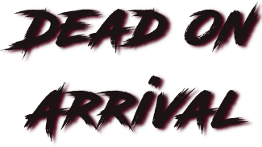
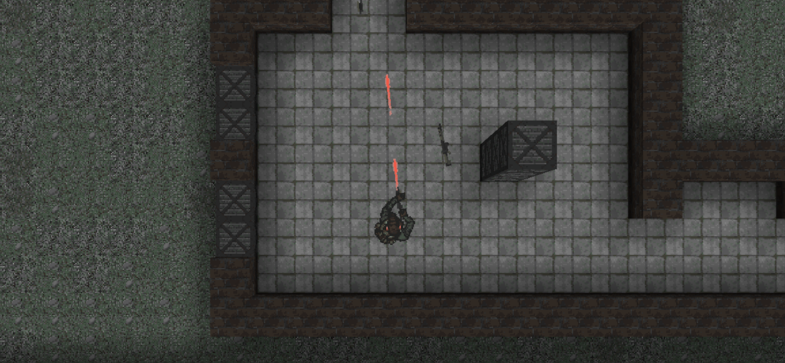
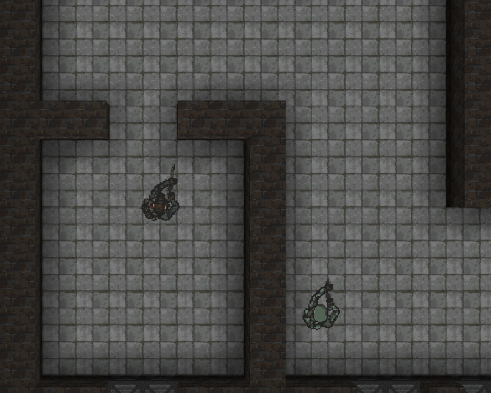
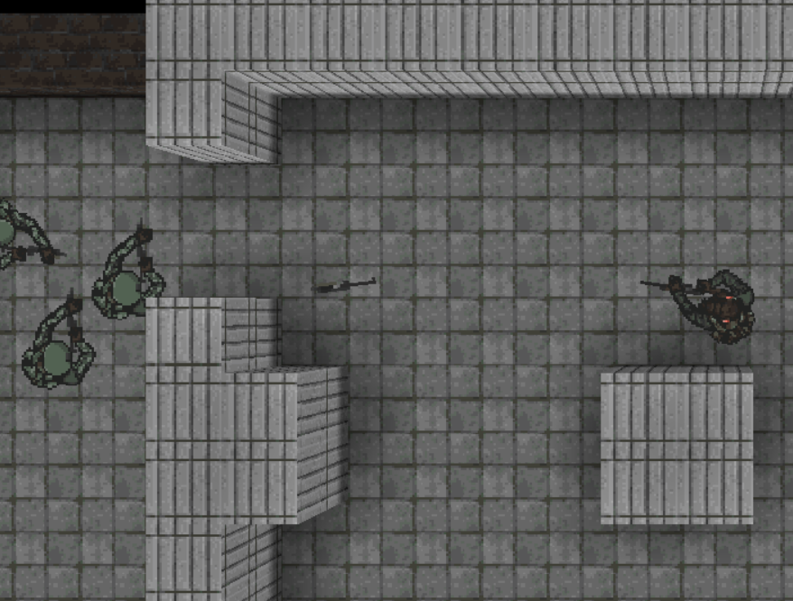

# 

---

## Requirements

- Python 3.10+
- Pyglet 2.0.15

## How to run this game

Make sure you have Python 3.10 installed (the best way is to create new venv).
To install packages run in project root: `pip install -r requirements.txt`.
If you've done above, you should be able to run: `python main.py`.

## Modding

Modding was made easy, everything is accessible as a plain file, without any 
archives or containers.

### Levels

Levels consist of two bitmap files - one specifies level walls and floors,
second one specifies item and enemy spawns.

### Sounds

Sounds are encoded using Vorbis, but as long Pyglet can play the sound file you
should be fine with any file format.

### Entity statistics

Most entity (weapons, characters, items) properties are accessible through JSON
files.

### Adding new directories

If you are doing more elaborate modding (adding new code and therefore assets)
you might want to add a new asset directory. You can include files by modifying
JSON pack file.
